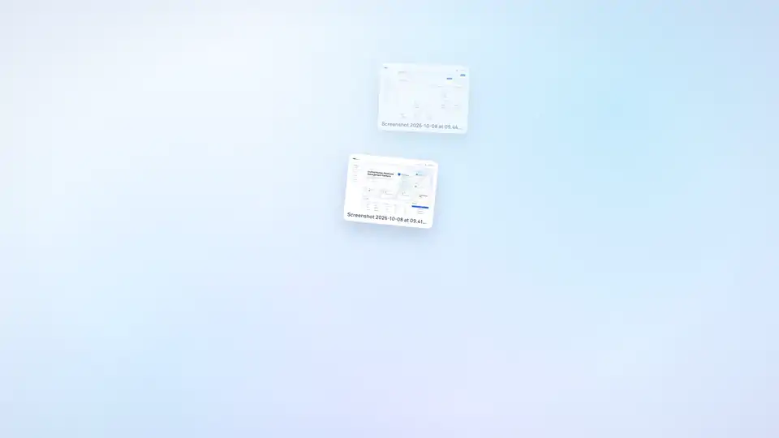
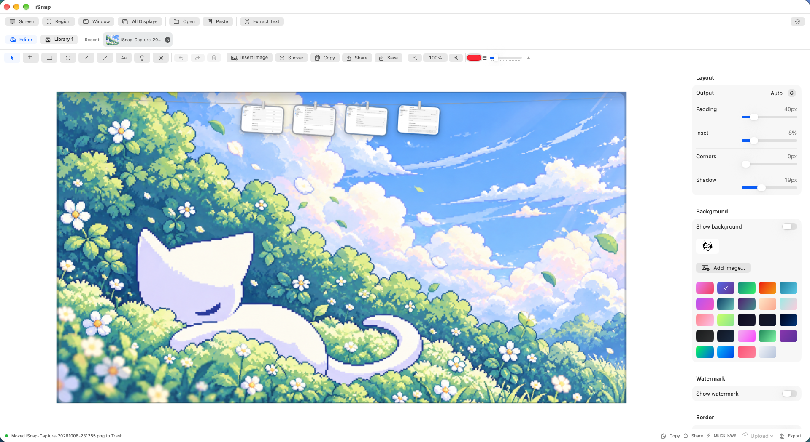
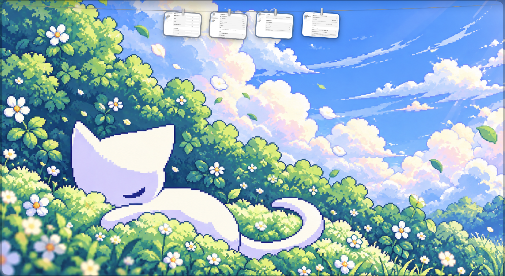
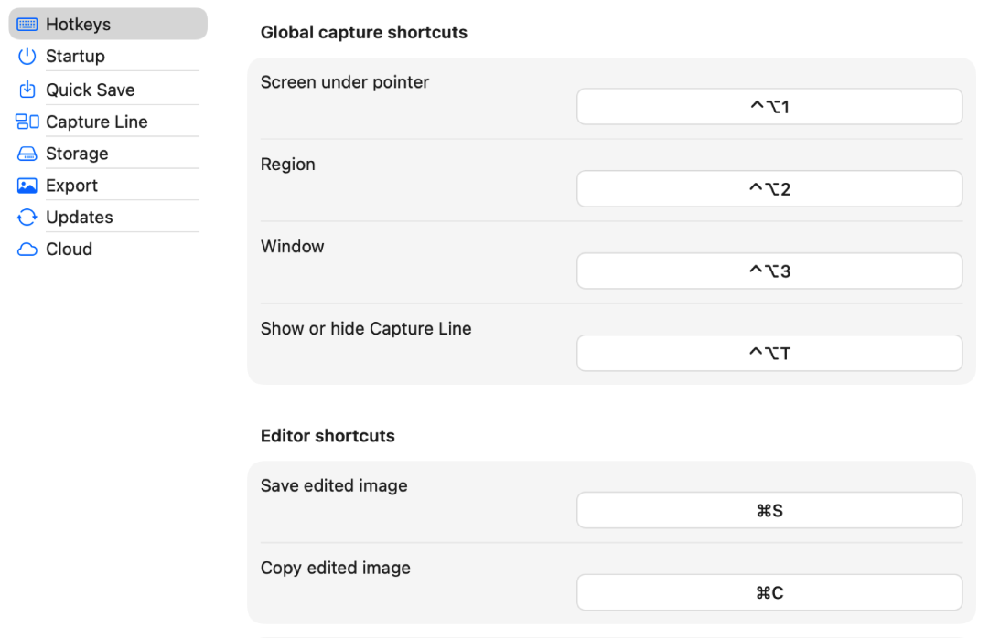
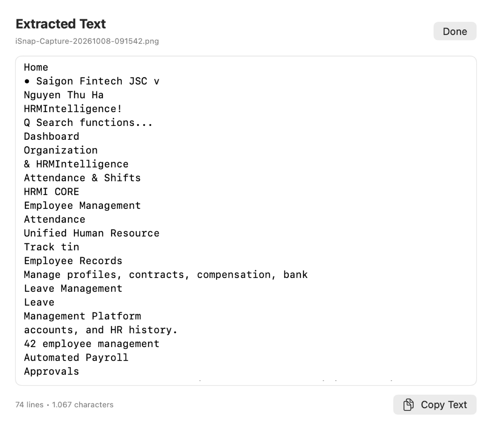
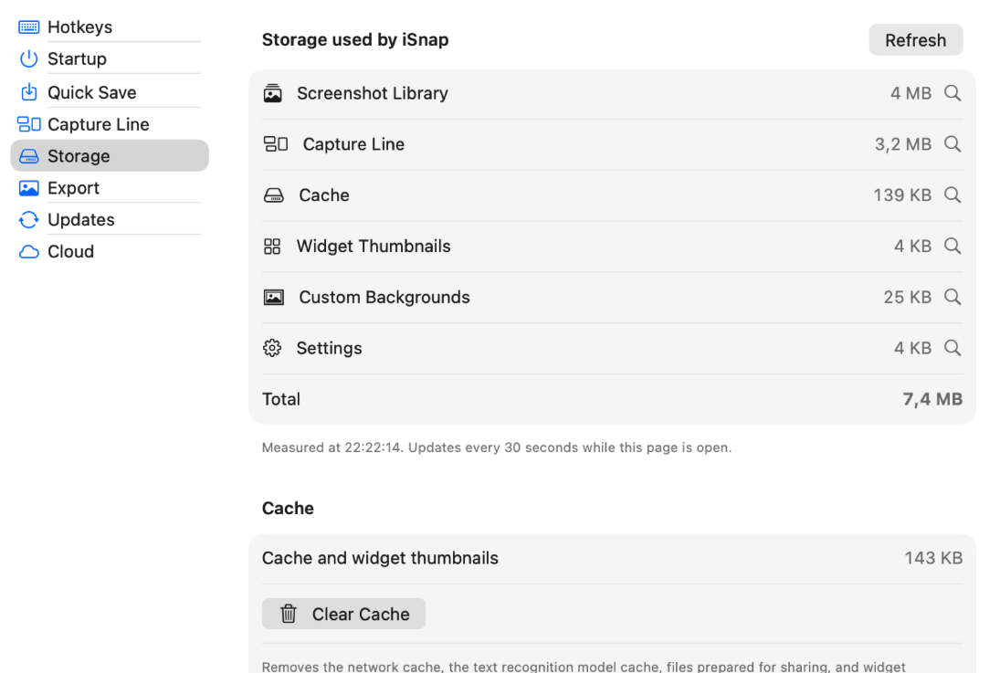

<p align="center">
  
</p>

<h1 align="center">iSnap</h1>

<p align="center"><b>The native macOS screenshot editor.</b><br>Capture any screen, annotate and beautify it, keep every capture hanging on a line under the menu bar, then share it anywhere.</p>

<p align="center">
  <a href="docs/assets/isnap-introduce.mp4"></a>
  <br>
  <sub>▶ <a href="docs/assets/isnap-introduce.mp4">Watch the full 40-second introduction with sound</a> · <a href="docs/USER_GUIDE.md">User guide</a></sub>
</p>

iSnap is written in Swift with SwiftUI, AppKit, and ScreenCaptureKit. No web view, no JavaScript runtime, and nothing leaves your Mac unless you choose to upload it.

## Highlights

### Capture the screen you are looking at

`⌃⌥1` captures the display under the pointer, `⌃⌥2` drags a region on any display, `⌃⌥3` picks an application window, and **All Displays** stitches every screen into one image. Captures open in the editor and are archived to your Library automatically. Region capture includes a pixel loupe, output dimensions and Space-drag repositioning; releasing the mouse captures immediately. Configurable workflows apply a preset/watermark and save, copy or explicitly opt into uploading with one shortcut.

### Annotate and beautify

Rectangles, ellipses, arrows (straight or curved), lines, text, numbered or lettered markers, spotlight, image overlays, and emoji stickers, all movable, resizable, and rotatable with undo/redo. Frame the result with 24 gradients or your own background, padding, rounded corners, shadow, border, output ratio, and a text or image watermark. Crop non-destructively. Name, hide, lock and reorder layers; use smart guides, snapping and exact X/Y/W/H values for alignment.

<p align="center"></p>

Select OCR regions to copy text or infer CSV columns. Combine saved images horizontally/vertically with captions, or export a multipage PDF. Export/upload work runs in the background with cancellation, upload retry and local link history. Autosaved drafts share image assets and keep a previous recovery snapshot; exported `.isnap` projects remain portable.

### The Capture Line

Every capture flies up and hangs on a line tucked under the menu bar, including screenshots taken with `⇧⌘3/4/5` and clipboard screenshots (`⌃⇧⌘3/4`). Click a card to copy it, double-click to edit it in iSnap, press and hold for Markup, drag it into any app or folder, or use its share button. Choose the **Classic**, **Cats**, **Rabbits**, or **Spider-Man** line in Settings (a bunny chases a carrot in Rabbits; three Spider-Men fire webs while a fourth drops in unexpectedly), pick **Show on Hover**, **Always Show**, or **Hide**, and toggle it any time with `⌃⌥T`.

<p align="center"></p>

### Share anywhere

One Share menu on Capture Line cards, in the editor, and in the Library: AirDrop, Messages, Mail, every macOS share extension, **Open With** any app, copy the image, the file, or its path, or upload to Cloudflare R2, Google Drive, or DocVault and copy the link.

### And more

- **Text extraction (OCR)** on device with macOS Vision, English and Vietnamese
- **Screenshot Library** with recent captures, quick open, reveal, and move to Trash
- **Storage** overview with live sizes per folder and one-click **Clear Cache**
- **Widgets** (small and medium) for recent screenshots
- **English and Tiếng Việt** interface, switchable from the menu bar icon
- PNG/JPEG export, quick save (`⌘S`), copy (`⌘C`), filename patterns, launch at login, and update checks
- **Editable projects and recovery:** save `.isnap` projects with original images, layers, crop state and embedded backgrounds; recover the last session and earlier drafts
- **Privacy tools:** solid redaction, blur, pixelation, and reviewed on-device suggestions for email addresses and phone numbers
- **Searchable Library:** local OCR search, tags, favorites, date filters, multiple selection and batch export with presets, watermarks, resizing and filename prefixes
- **Capture options:** repeat the last region, 3/5/10-second delay, optional cursor, and manual scrolling capture with overlap detection and seam review
- **Faster editing:** bounded cached previews, background autosave, group selection, keyboard nudging, duplication and alignment
- **Draft manager:** thumbnails, rename, bulk Trash and optional retention; Library adds Quick Look, range selection, sorting and highlighted OCR matches
- **Scrolling capture helpers:** session shortcut, zoomable seam detail, fixed header/footer trimming and optional one-step automatic scrolling
- **Reusable canvas presets** and floating pinned images with opacity and position lock

| Hotkeys | Text extraction | Storage |
| --- | --- | --- |
|  |  |  |

## Requirements

- macOS 14 Sonoma or later
- Screen Recording permission for display and window capture
- To build: Xcode 16 or later (validated with the Xcode 27 SDK) and [XcodeGen](https://github.com/yonaskolb/XcodeGen)

## Download and install

Download the `.dmg` (or the `.zip`) from the [latest release](https://github.com/Vhaooforjob/isnap/releases/latest).

See [what changed in 1.0.2 compared with 1.0.1](docs/releases/v1.0.2.md), including the Rabbits and Spider-Man Capture Line styles, animated characters and corrected card positioning.

**Requirements:** macOS 14 Sonoma or later, Apple Silicon or Intel.

1. Open the `.dmg` and drag **iSnap** into **Applications** (with the `.zip`, unzip it and move `iSnap.app` to Applications).
2. Open **iSnap** from Applications. The first time, macOS says it cannot verify the app, because it is not notarized by Apple. This is expected for an independent release. Choose one of:
   - **System Settings → Privacy & Security**, scroll to *"iSnap" was blocked*, click **Open Anyway**, then confirm. (On macOS 14, right-click the app and choose **Open** instead.)
   - Or run once in Terminal: `xattr -dr com.apple.quarantine /Applications/iSnap.app`
3. Grant permissions: On the first capture, macOS asks for access. Enable iSnap under **System Settings → Privacy & Security → Screen & System Audio Recording**, then restart iSnap.

Always run iSnap from **Applications** so macOS keeps your permissions. After an update you may have to toggle the permission off and on again, because this build is signed ad hoc. If you want to build from source instead, see below.

## Build from source

```bash
swift build
swift test
```

Build the app with Xcode:

```bash
xcodegen generate
xcodebuild -project iSnap.xcodeproj -scheme iSnap -configuration Release build
```

Copy the built `iSnap.app` to `/Applications` and open it. For a stable Screen Recording permission, sign with your Apple Development team and always run the copy in Applications. On first capture macOS asks for access; enable iSnap under **System Settings → Privacy & Security → Screen & System Audio Recording**, then restart iSnap from its recovery alert. If an older ad-hoc build is still listed, reset only its record with `tccutil reset ScreenCapture dev.isnap.app`.

See the [user guide](docs/USER_GUIDE.md) for every feature and shortcut.

## Project layout

The source is split into `App`, `Models`, `Services`, and `Views`. System operations sit behind native services, `EditorDocument` owns the editable state, and `ExportRenderer` is the single rendering path for the preview, the clipboard, and exported files. More in [docs/architecture.md](docs/architecture.md).

Documentation screenshots are rendered from the real views with demo data:

```bash
ISNAP_SHOTS_DIR=/tmp/isnap-shots ISNAP_DEMO_DIR=/path/to/demo-images swift test --filter MarketingShotsTests
```

## License and notices

iSnap is released under the [MIT License](LICENSE).

Third-party notices are listed in [THIRD_PARTY_NOTICES.md](THIRD_PARTY_NOTICES.md).
