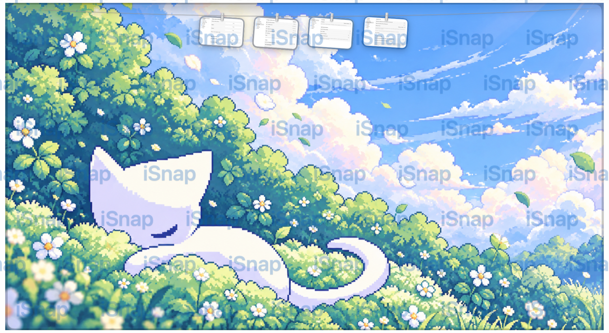
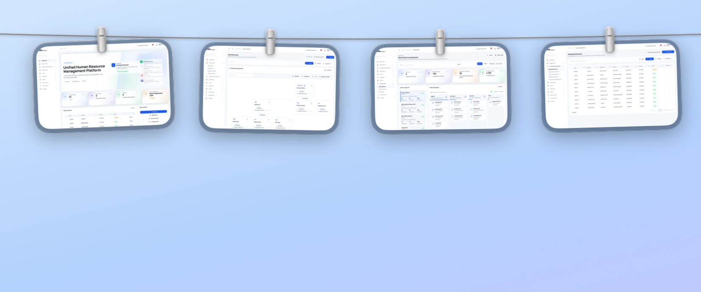
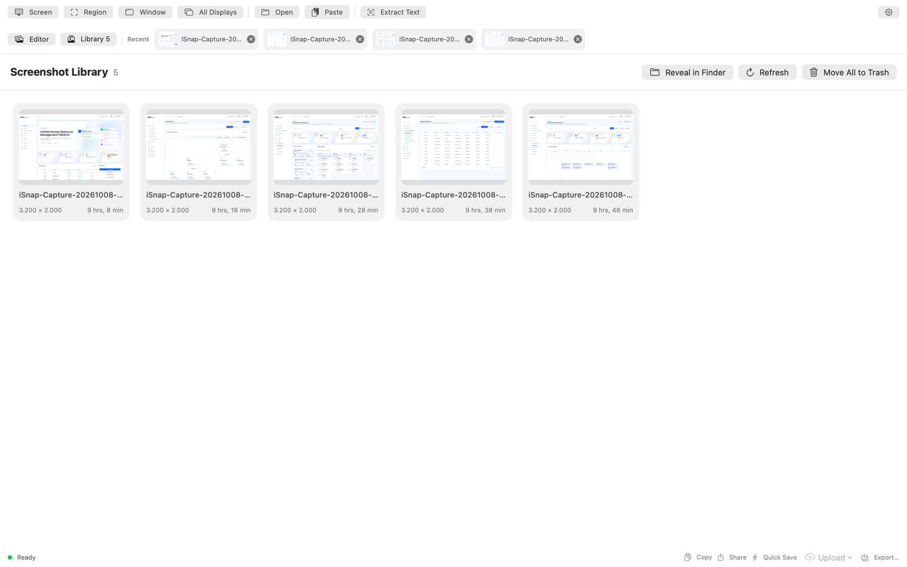
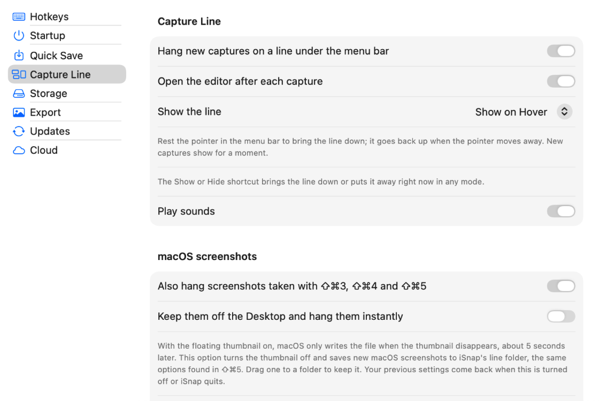

# iSnap user guide

iSnap lives in your menu bar (the viewfinder icon) and in a main window with an editor and a screenshot Library. This guide walks through every feature. For building from source, see the [README](../README.md).

- [Getting started](#getting-started)
- [Capturing](#capturing)
- [Editing](#editing)
- [The Capture Line](#the-capture-line)
- [Sharing](#sharing)
- [Library and widgets](#library-and-widgets)
- [Text extraction](#text-extraction)
- [Settings](#settings)
- [Storage and cache](#storage-and-cache)
- [Language](#language)
- [Keyboard shortcuts](#keyboard-shortcuts)
- [Troubleshooting](#troubleshooting)

## Getting started

1. Move `iSnap.app` to `/Applications` and open it. The viewfinder icon appears in the menu bar.
2. Take your first capture with `⌃⌥1`. macOS asks for **Screen Recording** access. Enable iSnap under **System Settings → Privacy & Security → Screen & System Audio Recording**, then choose **Restart iSnap** in the alert that iSnap shows.
3. To pick up screenshots you take with `⇧⌘3/4/5`, iSnap reads the folder macOS saves them to (usually the Desktop). macOS asks once whether iSnap may access that folder.

The menu bar icon gives you everything without opening the window:

| Item | What it does |
| --- | --- |
| Show iSnap | Opens the main window |
| Capture Screen · Region · Window · All Displays | Starts a capture; the current shortcut is shown next to each item |
| Capture Line › | Show on Hover, Always Show, Hide, Show or Hide Now (`⌃⌥T`), Take Everything Down |
| Screenshot Library | Opens the Library |
| Settings… | Opens Settings (`⌘,`) |
| Language › | System Default, English, Tiếng Việt |
| Quit iSnap | `⌘Q` |

## Capturing

| Mode | Default shortcut | Result |
| --- | --- | --- |
| Screen | `⌃⌥1` | The whole display under the pointer. With several displays, point at the one you want. |
| Region | `⌃⌥2` | Every display dims. Drag a rectangle on any of them; a pixel loupe and output pixel dimensions help position the edges. Hold **Space** during the drag to move the whole rectangle. Release the mouse to capture immediately; `Esc` cancels. |
| Window | `⌃⌥3` | A picker lists open windows with thumbnails; choose one. |
| All Displays | toolbar or menu | Every display stitched into one image. |

You can also **Open…** (`⌘O`) or **Paste** (`⌘V`) an image into the editor.

The **timer menu** in the capture toolbar adds **Capture Last Region**, a **3/5/10-second delay**, and **Include cursor**. The last region is kept for the current app session and checked against the connected display before reuse. Delays apply to screen, region, window, all-displays, and repeat-region captures.

### Capture workflows

Open **timer menu → Workflows → Manage Workflows…**. Give each workflow a name and a unique shortcut with modifiers (for example `⌃⌥9`), choose region or screen capture, an optional saved canvas preset and watermark text, and whether to save and/or copy. **Save Workflow** or **Save All** applies changes, including removals. The menu can also run a workflow. Conflicting shortcuts are reported in the manager.

The workflow captures, applies its style, saves/copies as configured and opens the editable source. **Stop Workflow** cancels remaining work; files already saved are kept. Region workflows also capture immediately on mouse release. Cloud actions are unavailable; older workflows with a saved upload destination still perform their local actions without uploading or replacing the clipboard with a link.

### Scrolling capture

Choose **Scrolling Capture…** in the timer menu or the Capture menu. Select a region containing the scrolling content, leaving fixed headers and scrollbars outside it. iSnap takes the first frame and opens a floating control panel.

1. Before the second frame, optionally enter **Top** and **Bottom** pixel counts under **Ignore fixed areas**. Those strips are removed from every frame, including the first; these values lock once another frame is captured.
2. Scroll down in the source app, keeping part of the previous frame visible, then press **⌃⌥N** from any app or click **Capture Next**. Alternatively enable **Scroll automatically before the next capture**: each capture scrolls the selected region once, then waits for it to settle. macOS Accessibility permission is required only for this option.
3. Review the stitched preview and the zoomable **Seam detail**. Adjust **Overlap (px)** if needed, then choose **Add Frame** (`⌘Return`). **Discard Frame** retries without changing accepted frames.
4. Repeat, then **Finish** to send the combined image to the normal editor, Library and Capture Line workflow. **Remove Last** undoes the last accepted frame; **Cancel** discards the session.

This captures a fixed region vertically. Automatic scrolling advances one step per request; every seam still requires review. Animated content, repeated patterns and sticky elements may need manual overlap adjustment. The global next-frame shortcut is registered only during a session; the panel reports if another app has reserved it. The output is limited to 60,000 pixels high and 80 million pixels in total.

After a capture:

- The editor opens with the image (turn this off in **Settings → Capture Line → Open the editor after each capture**).
- The capture is saved to the Library as `iSnap-Capture-<date>-<time>.png` when **Automatically save every capture to Library** is on (Settings → Quick Save).
- The capture flies up to the [Capture Line](#the-capture-line).

All shortcuts can be changed in **Settings → Hotkeys**: click a shortcut, then press a modifier combination plus a letter, number, or F1–F12.

## Editing

<p align="center"></p>

### Tools

| Tool | Key | Notes |
| --- | --- | --- |
| Select | `V` | Move, resize, and rotate annotations. `Delete` removes the selection. |
| Crop | `C` | Non-destructive. Pick a ratio (Free, 16:9, 4:3, 1:1, 9:16, 3:4), then **Apply**; **Reset** restores the original. |
| Rectangle | `R` | Stroke, fill, width, and corner radius from the toolbar. |
| Ellipse | `E` | |
| Arrow | `A` | Drag in any direction; can be curved. |
| Line | `L` | |
| Text | `T` | Click to place, then type in the popup. Double-click to edit later. |
| Number | `N` | Auto-numbered markers. Edit to switch to A, B, C or a, b, c, or to set the next value. |
| Spotlight | `S` | Dims everything outside the shape. |
| Redact | toolbar | Covers a rectangle with opaque black. |
| Blur | toolbar | Blurs the selected rectangle. |
| Pixelate | toolbar | Pixelates the selected rectangle. |

With the Select tool, **Shift-click** or **Command-click** toggles annotations in a group. Drag the group or use arrow keys to move it by one source pixel; hold **Shift** for ten pixels. **⌘A** selects all annotations, **⌘D** duplicates the selection, **⌘]** brings it to the front and **⌘[** sends it to the back. The layers menu also offers edge/center alignment for multiple annotations. Group operations undo together. Privacy masks remain above other annotations in the rendered image.

The right sidebar's **Layers** list supports names, visibility, locking and drag-to-reorder. Hidden layers are excluded from the preview and exported image; locked layers resist edits, moves, alignment and deletion. Their order and visibility can still be changed in the Layers list. Enter **X/Y/W/H** values and press Return to set the selected layer's frame in source pixels.

With **Snap** enabled, dragging a layer or group shows guides at image/object edges and centers, and at equal gaps between neighboring objects. Resizing also matches object dimensions. Hold **Option** to bypass snapping. Image overlays retain their aspect ratio while dragging the resize handle.

Preview bitmaps adapt to the view and zoom level and reuse their background. Saving, copying and exporting still use the full output resolution.

Also in the toolbar: **Insert Image** (an overlay with its own opacity), **Sticker** (emoji stickers), **Undo**/**Redo**, zoom (pinch on a trackpad, or the zoom buttons; **Fit** resets), **Copy**, **Share**, and **Save**.

The **… menu → Suggest Redactions…** scans the image on device for lines containing email addresses or phone numbers. Select the suggestions to apply; iSnap covers the whole selected line with opaque black. Review the image for information the detector missed. Use **Redact** when text must be completely covered; blur and pixelation are visual effects. Masks remain editable inside the project and are flattened into exported/copied images.

### Editable projects and recovery

**… → Save Project…** (`⌥⌘S`) stores a `.isnap` file containing the source image, editable annotations, crop state, canvas and embedded image assets. **Open Project…**, or double-clicking the project in Finder, restores those layers. Regular **Save** and **Export** still produce PNG/JPEG images.

iSnap saves the active draft shortly after changes and preserves the previous document before replacing it. It restores the latest session when launched. **… → Recent Drafts** opens previous documents. **Manage Drafts…** shows thumbnails, dates and sizes, with rename and multiple-selection Trash actions. Draft retention defaults to **Never**; optionally move drafts older than 7, 30 or 90 days to Trash on the next launch or opening of the manager. The latest and previous recovery sessions are always kept. If the latest recovery is unreadable, iSnap tries the previous one. **Show Drafts in Finder** opens the underlying folder. If preserving a draft fails, the editor keeps the current document. Drafts live in `~/Library/Application Support/iSnap/Drafts` and are not removed by Clear Cache.

Autosaved drafts share content-addressed image assets in `Drafts/.Assets`, keeping repeated changes small. Draft thumbnails are cached. Keep that folder with the draft manifests; use **Save Project…** to produce a portable single file. Drafts sent to Trash through the manager embed their assets first, so they can be restored independently. Unused shared assets are removed after draft cleanup; damaged manifests prevent cleanup to protect recovery data.

Projects and drafts retain the original pixels, including content underneath redactions. Share the exported PNG/JPEG when you intend to share only the rendered result.

### Canvas panel

The panel on the right styles the exported image:

- **Saved Presets:** name and save the current canvas configuration, then apply it with one click. Presets include custom backgrounds and watermarks; the trash button removes a preset.

- **Layout:** output ratio (Auto, 1:1, 4:3, 3:2, 16:9, 5:3, 9:16, 3:4, 2:3), padding, inset, corner radius, and shadow.
- **Background:** show or hide it, pick one of 24 gradients, or **Add Image…** for your own (up to eight are kept).
- **Watermark:** text or image, opacity, size, one of nine positions, or **Tile Entire Image**.
- **Border:** color, weight, and position (outside, center, or inside).

<p align="center"></p>

### Saving and exporting

| Action | Shortcut | Where it goes |
| --- | --- | --- |
| Save Edited Image | `⌘S` | The Library folder, named by your filename pattern |
| Export… | `⇧⌘S` | Anywhere, through a save panel |
| Copy Edited Image | `⌘C` | The clipboard, as rendered |
| Share | toolbar or status bar | See [Sharing](#sharing) |

Format (PNG or JPEG), JPEG quality, whether the canvas background is included, and copying after a quick save are set in **Settings → Export**.

Rendering and encoding exports and clipboard images run in the background. The status bar offers **Cancel Export**. Cancellation is cooperative; files already written are kept.

### Extract text and tables

**Extract Text** recognizes the current rendered image, including visible annotations and masks. In the result, click recognized text regions to select individual lines/cells, then **Copy Selection**. **Keep layout** preserves approximate horizontal spacing. **Export CSV…** exports selected regions, or all regions if none are selected, with columns inferred from their positions. Review inferred tables: OCR may merge cells or misread small text. The text editor and **Copy Text** remain available for correcting/copying the full text.

## The Capture Line

Captures hang on a line tucked under the menu bar, ready to use without opening a window.

<p align="center"></p>

Choose **Classic**, **Cats**, **Rabbits**, or **Spider-Man** in **Settings → Capture Line → Line style**. Classic keeps the compact glass cards and cord. Cats adds a small animated cat decoration above screenshot cards; the screenshots fill their own cards and use the same capacity as Classic. Rabbits adds three pastel bunnies, carrot clips, and a hopping rabbit chasing a carrot back and forth along the rope. Spider-Man uses white web strands, curved spiderwebs in the upper corners and along the line, and red and blue card borders. Small webs bloom at the ends of fired strands. Three mascots take turns shooting webs in distinct poses: standing with one hand, crouching with both hands, and lunging with one arm raised overhead. A fourth occasionally drops in upside down between them, bobs and swings, then retreats; its timing and position vary each visit. Both modes pause their animation while the line is hidden and respect Reduce Motion.

### Showing the line

Choose a mode from **menu bar icon → Capture Line** or **Settings → Capture Line → Show the line**:

| Mode | Behavior |
| --- | --- |
| **Show on Hover** | Rest the pointer in the menu bar and the line slides down; move away and it goes back up. New captures show for a moment. Clicking elsewhere puts it away. |
| **Always Show** | The line stays down while it has captures. |
| **Hide** | The line never comes down on its own, not even from the menu bar. Captures still hang on it. |

`⌃⌥T` (**Show or Hide Now**) brings the line down or puts it away immediately, in every mode. The line also hides while an app is in full screen.

### Working with a card

| Gesture | Result |
| --- | --- |
| Click | Copy the image |
| Double-click | Edit it in iSnap |
| Press and hold | Open it in the macOS Markup editor; saving writes back to the file |
| Drag into an app | Send a copy; the card stays on the line |
| Drag into a folder | Keep the file there (Library files are copied, never moved) |
| Drag to the Trash, or click the **×** | Take the card down |
| Share button (top right) | Open the [Share menu](#sharing) |
| Right-click | Copy, Edit in iSnap, Markup, Share, Open in Default App, Show in Finder, Save to Desktop, Take Down, Move to Trash |

**Take Everything Down** in the menu clears the line.

### Where captures come from

- **iSnap captures** (`⌃⌥1/2/3`).
- **macOS screenshots** (`⇧⌘3/4/5`), when **Also hang screenshots taken with ⇧⌘3, ⇧⌘4 and ⇧⌘5** is on. With the floating thumbnail on, macOS only writes the file when the thumbnail disappears, about five seconds later. Turn on **Keep them off the Desktop and hang them instantly** to switch the thumbnail off and save new macOS screenshots to iSnap's line folder; your previous screenshot settings come back when you turn it off or quit iSnap.
- **Clipboard screenshots** (`⌃⇧⌘3/4`), when **Also hang screenshots copied to the clipboard** is on. iSnap saves them to its line folder; they stay on the clipboard too. macOS may ask once whether iSnap can paste from other apps.

### What happens to the files

Captures that only live on the line (clipboard screenshots, routed macOS screenshots, and iSnap captures made while Library saving is off) are stored in `~/Library/Application Support/iSnap/Line` and go to the Trash when taken down. Files anywhere else, including your Library, are never deleted from the line. **Save to Desktop** keeps a line-only capture.

## Sharing

The same Share menu is available on Capture Line cards, in the editor toolbar and status bar, and in the Library (right-click → **Share…**). The editor shares the rendered image in your export format.

| Item | What it does |
| --- | --- |
| AirDrop · Messages · Mail | Share directly |
| More Sharing Options | Every macOS share extension (Notes, Photos, Freeform, …) |
| Open With › | Any app that opens images, default app first; **Other…** picks any app |
| Copy Image · Copy File · Copy Path | Paste the picture, attach the file (chat apps, Mail, Finder), or paste its path |
| Show in Finder | Reveal the file |

## Library and widgets

Use the Library search field to match filenames, tags or recognized text in images. Matching OCR snippets appear under cards with the match highlighted. Sort by newest, oldest, name, file size or pixel dimensions. OCR indexing runs locally in the background; an indexing indicator shows progress. **Refresh** retries images that could not be indexed. Very small text may not survive the bounded-resolution image used for indexing.

Use the star to mark favorites, filter by the last 7 or 30 days (file modification date), and choose **Edit Tags** to add comma-separated tags. Tags and favorites are stored locally by file path. Moving or renaming files outside iSnap does not migrate their tags automatically.

Click a checkbox or Command-click to select multiple images; **Shift-click** selects a range in the current sort order. With the grid focused, arrow keys navigate and **Shift-arrow** extends the selection. **Space** opens Quick Look; Left/Right browse images and Space/Escape closes it. **Return** opens the selected image in the editor. The Library refreshes when iSnap becomes active; deleting images also removes their OCR index and tags, including after deletion in Finder.

 **Select All** selects the currently filtered results. **Batch Export…** exports those images to a chosen folder with an optional saved preset or current canvas/watermark, PNG/JPEG format, maximum dimension and filename prefix. Leave the prefix blank to keep source names. Existing files are never overwritten; colliding names receive a suffix. **Stop Export** keeps files already completed. Batch export operates on the saved images in the Library, not unsaved editor layers.

Select saved images and choose **Combine / PDF…**, or open **… → Combine Images / PDF…** and add files. Change their order, edit captions and choose vertical/horizontal layout, spacing and size. **Open Combined Image** sends the result to the editor; **Export PNG…** writes it directly. **Export PDF…** uses one image per page in list order, with optional captions. PDF image dimensions are capped at 4096 pixels on the longest edge; combined PNGs are limited to 80 million pixels and 60,000 pixels per axis. These actions use saved source files, so save current edits first if you want them included.

**Pin on Screen** is available in the Library and Capture Line context menus, and in the editor's **… menu**. Each image floats above normal windows, with opacity, position/size lock, and a close button. Pinned images are independent of the source file and last for the current app session.

The **Library** shows every image in your Quick Save folder (default `~/Pictures/iSnap`), newest first. Double-click to open one in the editor; right-click for **Share…**, **Reveal in Finder**, and **Move to Trash**. Select images and choose **Move to Trash** to remove them together after confirmation; they can be recovered from the Trash. The most recent captures also appear in the **Recent** bar above the editor.

<p align="center"></p>

Add the **Recent Screenshots** widget (small or medium) from the macOS widget gallery to open or remove recent captures without opening iSnap.

## Text extraction

**Extract Text** (toolbar, or **Capture → Extract Text from Screenshot**) reads the text in the current image on your Mac with macOS Vision, including English and Vietnamese. **Copy Text** copies the result.

<p align="center"></p>

Cloud integrations are [in the backlog](BACKLOG.md#cloud-integrations), not an available feature starting with v1.0.4. Cloud settings, uploads, link history and workflow upload choices are hidden. Existing cloud configuration is retained but inactive.

## Settings

Open **Settings…** from the menu bar, the editor's gear button, or `⌘,`. Settings opens in a single independent popup without opening the editor. Repeating the command focuses that popup. Close it with **Done**, `Esc`, or the close button.

| Tab | What you can change |
| --- | --- |
| Hotkeys | Global capture shortcuts, the Capture Line shortcut, and editor Save/Copy shortcuts |
| Startup | Language, launch at login, start hidden, close to menu bar, sound after save |
| Quick Save | Library folder, filename pattern (timestamp, date, increment), automatic saving of captures |
| Capture Line | On/off, line style, opening the editor after captures, display mode, sounds, macOS and clipboard screenshot pickup |
| Storage | Sizes, Clear Cache, Capture Line cleanup |
| Export | Format, JPEG quality, canvas background, copy after quick save |
| Updates | Check on launch, check now |

<p align="center"></p>

## Storage and cache

**Settings → Storage** lists what iSnap keeps on disk: the Screenshot Library, Capture Line files, cache, widget thumbnails, custom backgrounds, and settings, with a total. Sizes refresh every 30 seconds while the page is open; the magnifier shows each location in Finder.

- **Clear Cache** removes the network cache, the text recognition model cache, files prepared for sharing, and widget thumbnails. iSnap rebuilds them when needed. Screenshots, backgrounds, and settings are kept.
- **Move Capture Line Files to Trash…** removes line-only captures after asking. Library screenshots are not touched.

<p align="center"></p>

## Language

Choose **System Default**, **English**, or **Tiếng Việt** from **menu bar icon → Language** or **Settings → Startup → Language**. iSnap offers to restart, which is when macOS loads the new language. Unsaved editor changes are lost on restart, so save first.

## Keyboard shortcuts

| Shortcut | Action |
| --- | --- |
| `⌃⌥1` | Capture the screen under the pointer |
| `⌃⌥2` | Capture a region |
| `⌃⌥3` | Capture a window |
| `⌃⌥T` | Show or hide the Capture Line now |
| `⌘O` / `⌘V` | Open / paste an image |
| `⌘S` / `⇧⌘S` | Save to Library / Export… |
| `⌘C` | Copy the edited image |
| `V` `C` `R` `E` `A` `L` `T` `N` `S` | Select, Crop, Rectangle, Ellipse, Arrow, Line, Text, Number, Spotlight |
| `Delete` | Delete selected annotations |
| Arrow keys / `Shift` + arrow | Move selected annotations 1 / 10 pixels |
| `⌘A` / `⌘D` (canvas focused) | Select all annotations / duplicate selection |
| `⌘]` / `⌘[` (canvas focused) | Bring selection to front / send to back |
| `Space` (Library grid focused) | Quick Look |
| `⌃⌥N` (scrolling session) | Capture next frame |
| `Esc` | Cancel a region selection |
| `⌘,` | Settings |

The global and Save/Copy shortcuts can be changed in Settings → Hotkeys.

## Troubleshooting

**"Screen Recording access needs attention".** macOS applies the permission to a running app only after a restart. Use **Restart iSnap** in the alert. If an old build is still listed in System Settings, remove it with `tccutil reset ScreenCapture dev.isnap.app` and grant access again.

**macOS screenshots do not appear on the line.** Check **Settings → Capture Line**: the folder iSnap watches is shown under **Watching**. If iSnap cannot read it, allow access in **System Settings → Privacy & Security → Files and Folders**, then **Try Again**. Screenshots copied to the clipboard need the clipboard option, and with the floating thumbnail on the file appears about five seconds after capture.

**The line does not come down.** In **Hide** mode it only appears with `⌃⌥T`. In **Show on Hover**, rest the pointer in the menu bar of the display you are using. It also stays hidden while an app is full screen.

**Diagnostics.** iSnap logs Capture Line activity. Run this in Terminal (use the full path; in zsh, `log` is a built-in):

```bash
/usr/bin/log show --last 10m --info --predicate 'subsystem == "dev.isnap.app"'
```
